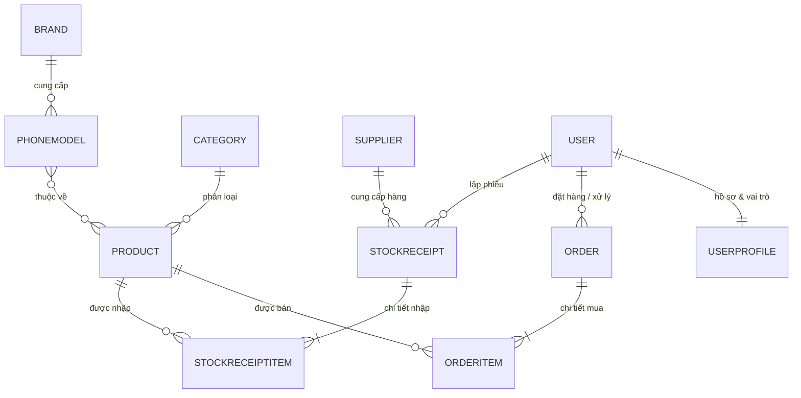

# Freshmak – Vegetable Management System 🥬🥦🥕

> **Hệ thống Website Quản lý Kinh doanh & Bán lẻ Nông sản, Rau Củ Quả Tươi Sạch**  
> Được xây dựng trên nền tảng **Python & Django Framework** theo mô hình MVT (Model - View - Template).

[](https://www.python.org/)
[](https://www.djangoproject.com/)
[](https://getbootstrap.com/)
[](https://www.sqlite.org/)
[](#-trạng-thái-dự-án--định-hướng-phát-triển)

---

## 📋 Mục lục

- [🌿 Giới thiệu dự án](#-giới-thiệu-dự-án)
- [✨ Tính năng nổi bật](#-tính-năng-nổi-bật)
  - [1. Phân hệ Cửa hàng (Khách hàng)](#1-phân-hệ-cửa-hàng-khách-hàng---storefront)
  - [2. Phân hệ Quản trị (Admin Panel)](#2-phân-hệ-quản-trị-admin-panel---quản-lý-kinh-doanh--kho)
  - [3. Tiêu chuẩn phân loại & Nghiệp vụ kho](#3-tiêu-chuẩn-phân-loại--nghiệp-vụ-kho-nông-sản)
- [🛠 Công nghệ sử dụng](#-công-nghệ-sử-dụng)
- [🖼 Giao diện ứng dụng (Screenshots)](#-giao-diện-ứng-dụng-screenshots)
- [📁 Cấu trúc thư mục dự án](#-cấu-trúc-thư-mục-dự-án)
- [🚀 Hướng dẫn cài đặt & Khởi chạy](#-hướng-dẫn-cài-đặt--khởi-chạy)
- [📖 Hướng dẫn sử dụng & Danh mục đường dẫn (Routes)](#-hướng-dẫn-sử-dụng--danh-mục-đường-dẫn-routes)
- [🗄 Cơ sở dữ liệu & Mô hình dữ liệu](#-cơ-sở-dữ-liệu--mô-hình-dữ-liệu)
- [👤 Tác giả](#-tác-giả)
- [📄 Giấy phép (License)](#-giấy-phép-license)
- [📌 Trạng thái dự án & Định hướng phát triển](#-trạng-thái-dự-án--định-hướng-phát-triển)

---

## 🌿 Giới thiệu dự án

**Freshmak – Vegetable Management System** là giải pháp phần mềm web toàn diện được thiết kế chuyên biệt cho mô hình kinh doanh, phân phối và bán lẻ nông sản, rau củ quả tươi sạch (tương tự chuỗi Bách Hóa Xanh, Nông sản Sạch).

Dự án giải quyết trọn vẹn bài toán vận hành 2 chiều:
1. **Khách hàng tiêu dùng (Customer):** Trải nghiệm mua sắm tiện lợi, tìm kiếm nông sản theo xuất xứ vùng miền (Đà Lạt, Vĩnh Long, Long An, Hàng Nhập Khẩu...), xem chứng nhận chất lượng (VietGAP, Hữu cơ Organic), đặt hàng online nhận tận nơi và tra cứu tiến độ đơn hàng minh bạch.
2. **Chủ cửa hàng / Bộ phận quản trị (Admin):** Nắm bắt dashboard doanh thu - lợi nhuận gộp theo thời gian thực, quản lý danh mục sản phẩm, kiểm soát tồn kho tự động, nhập kho từ nhà cung cấp với công thức tính **giá vốn bình quân gia quyền**, xử lý và thay đổi trạng thái đơn hàng linh hoạt.

> Dự án phù hợp làm đồ án môn học, đồ án tốt nghiệp chuyên ngành Công nghệ thông tin / Kỹ thuật phần mềm, hoặc ứng dụng nền tảng để triển khai website kinh doanh nông sản thực tế.

---

## ✨ Tính năng nổi bật

### 1. Phân hệ Cửa hàng (Khách hàng - Storefront)
- 🛒 **Trang chủ & Danh mục nông sản:** Hiển thị sản phẩm trực quan theo nhóm (Rau lá & Gia vị, Củ & Khoai, Trái cây tươi, Nấm & Rau mầm, Gia vị đặc sản).
- 🔍 **Bộ lọc & Tìm kiếm thông minh:** Tìm kiếm nhanh theo tên sản phẩm, mã SKU, danh mục, xuất xứ nguồn gốc hoặc giống loại cụ thể.
- 🏷 **Trang tra cứu xuất xứ (Origin & Variety):** Tìm kiếm chuyên sâu theo vùng trồng trọt hoặc nguồn cung cấp (Đà Lạt, Vĩnh Long, Đắk Lắk, Nhập khẩu...).
- 📦 **Trang chi tiết sản phẩm:** Cung cấp thông tin giá bán lẻ, trạng thái kho hàng, xếp hạng tiêu chuẩn chất lượng và gợi ý sản phẩm cùng danh mục.
- 🛍 **Giỏ hàng trực tuyến (Session Cart):** Thêm, bớt, cập nhật số lượng hoặc xóa sản phẩm linh hoạt; tự động kiểm tra số lượng tồn kho khả dụng để tránh đặt quá số lượng thực tế.
- 📝 **Đặt hàng & Thanh toán (Checkout):** Nhập thông tin người nhận, số điện thoại, địa chỉ giao hàng và ghi chú đơn hàng; hỗ trợ phương thức nhận hàng thanh toán (COD).
- 📜 **Quản lý đơn mua (Order Tracking):** Xem lịch sử toàn bộ đơn hàng của tài khoản, chi tiết từng món hàng, tổng tiền và trạng thái xử lý đơn.
- 🔐 **Xác thực người dùng:** Đăng ký tài khoản khách hàng mới, đăng nhập, đăng xuất an toàn với phân quyền tự động.

### 2. Phân hệ Quản trị (Admin Panel - Quản lý kinh doanh & Kho)
- 📊 **Dashboard điều hành thông minh:**
  - Doanh thu trong ngày & Lợi nhuận gộp trong ngày (Gross Profit).
  - Số đơn hàng mới đang chờ xử lý (`PENDING`).
  - Tổng số lượng SKU đang kinh doanh.
  - Cảnh báo tồn kho nguy cơ: Sản phẩm sắp hết hàng (`Low stock`) và sản phẩm đã hết hàng (`Out of stock`).
  - Tổng giá trị định giá kho hàng theo giá vốn (Cost) và theo giá bán lẻ (Retail).
  - Danh sách đơn hàng mới nhất cần duyệt.
- 🥬 **Quản lý kho sản phẩm (Product Inventory):**
  - Danh sách sản phẩm đầy đủ với bộ lọc theo trạng thái tồn kho (Hết hàng / Sắp hết hàng) và danh mục.
  - Thêm mới sản phẩm: Mã SKU duy nhất, tên sản phẩm, danh mục, tiêu chuẩn kiểm định, giá vốn, giá bán, số lượng tồn ban đầu, định mức cảnh báo tồn tối thiểu, vị trí quầy/kệ trưng bày.
  - Chỉnh sửa và cập nhật thông tin sản phẩm dễ dàng.
- 📥 **Quản lý Nhập kho (Stock Receipts):**
  - Lập phiếu nhập kho từ Nhà cung cấp (Supplier).
  - Cho phép nhập đồng thời nhiều mặt hàng với số lượng và đơn giá nhập khác nhau trong cùng một phiếu.
  - **Tự động cập nhật Giá vốn bình quân (Weighted Average Cost):** Công thức tự động điều chỉnh giá vốn sản phẩm dựa trên số lượng tồn cũ và số lượng nhập mới.
  - Tự động cộng dồn số lượng tồn kho ngay khi lưu phiếu nhập.
- 🚚 **Quản lý Đơn hàng & Duyệt đơn (Order Management):**
  - Danh sách đơn hàng toàn hệ thống kèm bộ lọc trạng thái: *Chờ xác nhận*, *Đã xác nhận & Chuẩn bị hàng*, *Đang giao hàng*, *Hoàn thành*, *Đã hủy*.
  - Xem chi tiết giá bán, giá vốn, doanh thu và biên độ lợi nhuận từng mặt hàng trong đơn.
  - **Cơ chế hoàn trả kho thông minh:** Khi quản trị viên chuyển trạng thái đơn sang *Đã hủy*, số lượng hàng trong đơn sẽ tự động được hoàn trả về kho; nếu khôi phục lại từ trạng thái hủy, kho hàng sẽ được khấu trừ tương ứng.
- 👥 **Phân quyền người dùng (User Management):**
  - Danh sách tài khoản trong hệ thống.
  - Phân cấp quyền rõ ràng giữa `ADMIN` (Quản trị viên) và `USER` (Khách hàng).
- 🌱 **Khởi tạo dữ liệu mẫu (Seed Data):**
  - Tích hợp sẵn endpoint khởi tạo nhanh danh mục, vùng xuất xứ, giống loại, nhà cung cấp và 17+ mặt hàng rau củ quả thực tế chỉ với một thao tác.
- ⚙️ **Django Admin gốc:** Cung cấp đầy đủ giao diện quản trị dữ liệu cấp cao tại `/admin/`.

### 3. Tiêu chuẩn phân loại & Nghiệp vụ kho nông sản
Hệ thống thiết lập các mã phân loại chất lượng nông sản thực tế:
- **`ZIN` - Hữu cơ (Organic):** Nông sản canh tác hữu cơ đạt chuẩn an toàn cao nhất.
- **`LK1` - Sạch (VietGAP):** Nông sản đạt tiêu chuẩn thực hành sản xuất nông nghiệp tốt.
- **`OEM` - Thường:** Hàng nông sản tiêu chuẩn thông thường.
- **`DLC` - Nhập khẩu (Import):** Các dòng trái cây, nấm nhập khẩu chính ngạch (Mỹ, Nhật, Hàn Quốc...).

---

## 🛠 Công nghệ sử dụng

| Tầng công nghệ | Công nghệ / Thư viện | Mô tả chi tiết |
| :--- | :--- | :--- |
| **Backend** | **Python (3.10 - 3.13)** | Ngôn ngữ lập trình chính của hệ thống |
| **Framework** | **Django (5.x - 6.x)** | Web Framework theo kiến trúc MVT, mạnh mẽ, bảo mật cao |
| **Frontend** | **HTML5 & CSS3** | Cấu trúc giao diện ngữ nghĩa, thiết kế Responsive |
| | **JavaScript (ES6+)** | Xử lý tương tác giỏ hàng, form nhập liệu nhiều dòng động |
| | **Bootstrap 5.3.3** | UI Framework hiện đại, hệ thống Grid linh hoạt |
| | **Bootstrap Icons 1.11** | Bộ biểu tượng giao diện trực quan |
| | **Google Fonts (Inter)** | Typography cao cấp, thẩm mỹ |
| **Database** | **SQLite (`db.sqlite3`)** | Cơ sở dữ liệu mặc định gọn nhẹ, không yêu cầu cài đặt server phụ |
| | **Django ORM** | Tương tác cơ sở dữ liệu an toàn, chống SQL Injection |
| **Kiến trúc & Bảo mật** | **Session-based Cart** | Lưu trữ giỏ hàng độc lập theo phiên duyệt web |
| | **Database Transactions (`atomic`)** | Bảo đảm toàn vẹn giao dịch khi trừ kho, nhập hàng và hủy đơn |
| | **Django Auth & Signals** | Quản lý người dùng, tự động khởi tạo UserProfile qua `post_save` |

---

## 🖼 Giao diện ứng dụng (Screenshots)

> *Dưới đây là sơ đồ bố cục các màn hình chính của hệ thống. Bạn có thể thêm hình ảnh chụp thực tế vào thư mục `docs/screenshots/` theo hướng dẫn bên dưới.*

### 1. Phân hệ Khách hàng (Storefront)
```
+-----------------------------------------------------------------------------------+
|  FreshMart  [Rau lá] [Củ/Khoai] [Trái cây] [Nấm]  [ 🔍 Tìm kiếm... ]  🛒 Giỏ hàng |
+-----------------------------------------------------------------------------------+
|  Banner Nông Sản Tươi Sạch Mỗi Ngày - Đạt Chuẩn VietGAP & Organic                 |
+-----------------------------------------------------------------------------------+
|  [ Bộ Lọc Nguồn Gốc ]    |  Danh Sách Sản Phẩm Rau Củ Tươi                        |
|  - Đà Lạt               |  +----------------+  +----------------+  +------------+ |
|  - Vĩnh Long            |  | Rau Muống (bó) |  | Cà Chua Beef   |  | Bơ Sáp 034 | |
|  - Long An              |  | 8.000 đ [VietGAP| | 39.000 đ [ZIN] |  | 55.000 đ   | |
|  - Nhập Khẩu            |  | [Thêm Giỏ Hàng]|  | [Thêm Giỏ Hàng]|  | [Thêm Giỏ] | |
+-----------------------------------------------------------------------------------+
```

### 2. Phân hệ Quản trị (Admin Panel Dashboard)
```
+-----------------------------------------------------------------------------------+
|  ADMIN PANEL   | [Doanh Thu Hôm Nay] [Lợi Nhuận Gộp] [Đơn Chờ Duyệt] [Tồn Kho Thấp]|
|  - Tổng quan   |      1.250.000 đ        480.000 đ          3 đơn         2 SP    |
|  - Kho sản phẩm+-------------------------------------------------------------------+
|  - Nhập kho    |  📊 Biểu đồ & Danh sách đơn đặt hàng mới cần duyệt               |
|  - Đơn hàng    |  📦 Cảnh báo hàng dưới mức tối thiểu cần nhập kho                |
|  - Tài khoản   |  💰 Định giá tồn kho: Giá vốn: 15.200.000 đ | Giá bán: 24.500.000 đ|
+-----------------------------------------------------------------------------------+
```

#### 📸 Hướng dẫn thêm ảnh chụp màn hình vào dự án:
1. Tạo thư mục chứa ảnh trong repository:
   ```bash
   mkdir -p docs/screenshots
   ```
2. Chụp màn hình và lưu ảnh vào thư mục tương ứng:
   - `docs/screenshots/home_shop.png` – Giao diện trang chủ cửa hàng
   - `docs/screenshots/cart_checkout.png` – Giao diện giỏ hàng & đặt hàng
   - `docs/screenshots/admin_dashboard.png` – Giao diện Dashboard quản trị
   - `docs/screenshots/stock_receipt.png` – Giao diện lập phiếu nhập kho
3. Bỏ comment các thẻ ảnh sau trong README.md:
   <!--  -->
   <!--  -->

---

## 📁 Cấu trúc thư mục dự án

Repository được tổ chức theo chuẩn cấu trúc dự án Django rõ ràng và module hóa:

```text
Djago/
├── QuanLi/                        # Thư mục cấu hình cốt lõi của Django Project
│   ├── __init__.py
│   ├── asgi.py                    # Cấu hình máy chủ ASGI (Asynchronous)
│   ├── settings.py                # Thiết lập hệ thống, Database, Apps, Middleware
│   ├── urls.py                    # Khai báo tuyến đường URL gốc
│   └── wsgi.py                    # Cấu hình máy chủ WSGI (Deployment)
│
├── home/                          # Ứng dụng chính (Core App) quản lý toàn bộ nghiệp vụ
│   ├── migrations/                # Lịch sử các bước thay đổi cấu trúc bảng CSDL
│   │   ├── 0001_initial.py
│   │   ├── 0002_userprofile.py
│   │   ├── 0003_alter_order_options_order_customer_user_and_more.py
│   │   └── 0004_alter_brand_options_alter_category_options_and_more.py
│   ├── templates/                 # Giao diện HTML (Django Template Language)
│   │   ├── admin_panel/           # Giao diện dành riêng cho Quản trị viên
│   │   │   ├── base_admin.html    # Layout khung quản trị (Sidebar, Topbar)
│   │   │   ├── dashboard.html     # Thống kê doanh thu, tồn kho, đơn hàng
│   │   │   ├── product_list.html  # Quản lý danh mục & trạng thái sản phẩm
│   │   │   ├── product_form.html  # Form thêm mới / cập nhật sản phẩm
│   │   │   ├── receipt_list.html  # Lịch sử các phiếu nhập kho
│   │   │   ├── receipt_form.html  # Lập phiếu nhập kho từ nhà cung cấp
│   │   │   ├── order_list.html    # Danh sách đơn hàng bán lẻ & duyệt đơn
│   │   │   ├── order_detail.html  # Chi tiết đơn hàng, doanh thu & lợi nhuận
│   │   │   └── user_management.html # Phân quyền tài khoản (ADMIN/USER)
│   │   ├── shop/                  # Giao diện dành cho Khách hàng mua sắm
│   │   │   ├── base_shop.html     # Layout khung mua sắm (Navbar, Footer, Giỏ)
│   │   │   ├── home.html          # Danh sách sản phẩm, banner, bộ lọc
│   │   │   ├── product_detail.html# Chi tiết sản phẩm, xuất xứ, tiêu chuẩn
│   │   │   ├── compatibility.html # Tra cứu nông sản theo xuất xứ & giống loại
│   │   │   ├── cart.html          # Giỏ hàng & điều chỉnh số lượng
│   │   │   ├── checkout.html      # Trang điền thông tin giao hàng & đặt mua
│   │   │   ├── my_orders.html     # Danh sách đơn hàng đã mua của khách
│   │   │   └── my_order_detail.html# Chi tiết trạng thái đơn mua cá nhân
│   │   └── inventory/             # Giao diện xác thực
│   │       ├── login.html         # Đăng nhập hệ thống
│   │       └── signup.html        # Đăng ký tài khoản khách hàng
│   ├── admin.py                   # Đăng ký các Model vào trang Django Admin gốc
│   ├── apps.py                    # Cấu hình App home
│   ├── context_processors.py      # Bộ xử lý dữ liệu chung (Context giỏ hàng toàn cục)
│   ├── models.py                  # Định nghĩa cơ sở dữ liệu (Brand, Product, Order...)
│   ├── urls.py                    # Tuyến đường chi tiết của ứng dụng
│   └── views.py                   # Toàn bộ Controller/Logic xử lý nghiệp vụ
│
├── .gitignore                     # Cấu hình bỏ qua các file tạm thời, cache, venv
├── db.sqlite3                     # File CSDL SQLite thực tế chứa dữ liệu mẫu
├── manage.py                      # Script dòng lệnh điều hành dự án Django
├── requirements.txt               # Danh sách thư viện phụ thuộc
└── README.md                      # Tài liệu hướng dẫn sử dụng dự án
```

---

## 🚀 Hướng dẫn cài đặt & Khởi chạy

Thực hiện tuần tự các bước sau để thiết lập môi trường và khởi chạy dự án trên máy tính của bạn:

### 1. Chuẩn bị môi trường
- Đảm bảo máy tính đã cài đặt **Python 3.10** trở lên. Kiểm tra bằng lệnh:
  ```bash
  python --version
  # hoặc trên Windows nếu dùng py launcher:
  py --version
  ```
- Git (để tải mã nguồn).

### 2. Tải mã nguồn về máy
```bash
git clone https://github.com/DuongNeeee207/Djago.git
cd Djago
```
*(Nếu bạn tải file ZIP, hãy giải nén và mở terminal/PowerShell tại thư mục chứa file `manage.py`).*

### 3. Tạo và kích hoạt môi trường ảo (Virtual Environment)
- **Trên Windows (cmd / PowerShell):**
  ```powershell
  python -m venv venv
  .\venv\Scripts\activate
  ```
- **Trên macOS / Linux:**
  ```bash
  python3 -m venv venv
  source venv/bin/activate
  ```

### 4. Cài đặt các thư viện cần thiết
```bash
pip install -r requirements.txt
```

### 5. Cập nhật cơ sở dữ liệu (Migration)
Dự án đã có sẵn các migration chuẩn hóa nghiệp vụ rau củ quả. Chạy lệnh migrate để đồng bộ vào cơ sở dữ liệu:
```bash
python manage.py migrate
```

### 6. Tạo tài khoản Quản trị viên (Superuser)
Để truy cập trang Quản trị (Admin Panel) và Django Admin, hãy tạo một tài khoản quản trị của riêng bạn:
```bash
python manage.py createsuperuser
```
*Nhập Tên đăng nhập (username), Email (có thể để trống) và Mật khẩu theo hướng dẫn trên màn hình.*

> **Lưu ý phân quyền:** Khi tạo tài khoản qua lệnh `createsuperuser`, hệ thống sẽ tự động gán vai trò `ADMIN` cho tài khoản này.

### 7. Khởi chạy máy chủ phát triển (Development Server)
```bash
python manage.py runserver
```

Mở trình duyệt và truy cập vào đường dẫn:
```text
http://127.0.0.1:8000/
```

### 8. (Tùy chọn) Nạp dữ liệu mẫu ban đầu (Seed Data)
Nếu bạn khởi tạo database mới chưa có dữ liệu, hãy:
1. Đăng nhập bằng tài khoản Quản trị vừa tạo tại: `http://127.0.0.1:8000/login/`
2. Truy cập đường dẫn: `http://127.0.0.1:8000/manage/seed-data/`
3. Hệ thống sẽ tự động tạo sẵn danh mục, nguồn gốc xuất xứ (Đà Lạt, Vĩnh Long, Long An, Nhập khẩu...), nhà cung cấp và hơn 17 mặt hàng rau củ quả chuẩn thực tế để kiểm thử ngay.

---

## 📖 Hướng dẫn sử dụng & Danh mục đường dẫn (Routes)

### 1. Dành cho Khách hàng (User)
Khách hàng có thể trải nghiệm mua sắm trực tuyến không cần đăng nhập ban đầu, và chỉ cần đăng nhập khi tiến hành đặt đơn:

| Chức năng | Đường dẫn (URL) | Mô tả chi tiết |
| :--- | :--- | :--- |
| **Cửa hàng / Trang chủ** | `/` | Xem danh sách rau củ quả, lọc theo danh mục & nguồn gốc |
| **Tra cứu xuất xứ** | `/compatibility/` | Tìm kiếm nông sản theo xuất xứ vùng miền & giống loại |
| **Chi tiết sản phẩm** | `/product/<id>/` | Xem đơn giá, tiêu chuẩn kiểm định, tình trạng tồn kho |
| **Giỏ hàng** | `/cart/` | Quản lý sản phẩm đã chọn, điều chỉnh số lượng |
| **Đặt hàng (Checkout)** | `/checkout/` | Nhập địa chỉ, số điện thoại, ghi chú giao hàng (Yêu cầu đăng nhập) |
| **Đơn mua của tôi** | `/my-orders/` | Theo dõi danh sách đơn hàng đã mua và trạng thái đơn |
| **Chi tiết đơn mua** | `/my-orders/<id>/` | Xem chi tiết từng món hàng trong đơn đã đặt |
| **Đăng ký tài khoản** | `/signup/` | Tạo tài khoản khách hàng mới |
| **Đăng nhập** | `/login/` | Đăng nhập vào hệ thống |
| **Đăng xuất** | `/logout/` | Đăng xuất tài khoản an toàn |

### 2. Dành cho Quản trị viên (Admin)
Quản trị viên sau khi đăng nhập tài khoản có quyền `ADMIN` sẽ có toàn quyền truy cập bộ công cụ quản lý:

| Chức năng | Đường dẫn (URL) | Mô tả chi tiết |
| :--- | :--- | :--- |
| **Bàn làm việc Quản trị** | `/manage/` | Dashboard tổng hợp doanh thu, lãi gộp, tồn kho & đơn mới |
| **Kho rau củ quả** | `/manage/products/` | Danh sách kho sản phẩm, lọc hàng hết/sắp hết |
| **Thêm mới sản phẩm** | `/manage/products/create/` | Nhập thông tin, giá vốn, giá bán, vị trí kệ của sản phẩm |
| **Chỉnh sửa sản phẩm** | `/manage/products/<id>/edit/`| Điều chỉnh thông tin sản phẩm và liên kết giống loại |
| **Quản lý đơn hàng** | `/manage/orders/` | Danh sách đơn hàng từ khách, tổng doanh thu & tổng lợi nhuận |
| **Chi tiết & Duyệt đơn** | `/manage/orders/<id>/` | Xem đơn, duyệt chuyển trạng thái (tự động xử lý kho) |
| **Quản lý nhập kho** | `/manage/receipts/` | Xem danh sách các phiếu nhập hàng từ nhà cung cấp |
| **Lập phiếu nhập kho** | `/manage/receipts/create/` | Nhập hàng nhiều món, tự động tính giá vốn bình quân |
| **Phân quyền người dùng** | `/manage/users/` | Quản lý danh sách tài khoản, chuyển quyền Quản trị / Khách |
| **Khởi tạo dữ liệu mẫu** | `/manage/seed-data/` | Nạp nhanh dữ liệu rau củ quả mẫu |
| **Django Admin** | `/admin/` | Trang quản trị hệ thống mở rộng của Django |

---

## 🗄 Cơ sở dữ liệu & Mô hình dữ liệu

Hệ thống sử dụng cơ sở dữ liệu quan hệ (RDBMS) với các mô hình thực thể chính được thiết kế chuẩn mực:



### Chi tiết các thực thể dữ liệu (Models)
1. **`Brand` (Xuất xứ / Nguồn gốc):** Vùng miền hoặc xuất xứ trồng trọt (Đà Lạt, Vĩnh Long, Long An, Hàng Nhập Khẩu...).
2. **`PhoneModel` (Giống loại cụ thể):** Các giống nông sản cụ thể gắn với xuất xứ (Cà chua beef, Rau muống nước, Xoài cát Hòa Lộc, Bơ sáp 034, Nho đỏ Mỹ...).
3. **`Category` (Danh mục sản phẩm):** Phân nhóm mặt hàng (Rau lá, Củ & Khoai, Trái cây, Nấm & Rau mầm, Gia vị tươi).
4. **`Supplier` (Nhà cung cấp):** Thông tin đối tác cung cấp nông sản (Tên, số điện thoại, địa chỉ).
5. **`Product` (Sản phẩm Rau củ quả):**
   - Mã SKU, Tên sản phẩm, Danh mục, Tiêu chuẩn chất lượng (`ZIN` - Hữu cơ, `LK1` - VietGAP, `OEM` - Thường, `DLC` - Nhập khẩu).
   - Giá vốn (`cost_price`), Giá bán lẻ (`retail_price`), Tồn kho thực tế (`stock_quantity`), Mức cảnh báo tồn tối thiểu (`min_stock_alert`), Vị trí quầy/kệ (`location`).
6. **`StockReceipt` & `StockReceiptItem` (Phiếu nhập kho):**
   - Lưu trữ mã phiếu, nhà cung cấp, người lập, ngày nhập, tổng tiền nhập và chi tiết từng mặt hàng nhập kho.
   - **Công thức Giá vốn bình quân:** Khi nhập thêm số lượng $Q_{moi}$ với giá $P_{moi}$ vào lô tồn $Q_{cu}$ có giá vốn $P_{cu}$:
     $$P_{von\_moi} = \frac{(Q_{cu} \times P_{cu}) + (Q_{moi} \times P_{moi})}{Q_{cu} + Q_{moi}}$$
7. **`Order` & `OrderItem` (Đơn đặt hàng):**
   - Mã đơn, tài khoản đặt hàng, thông tin người nhận (tên, số điện thoại, địa chỉ), trạng thái đơn hàng.
   - Tự động tính toán: Tổng tiền thanh toán (`total_amount`), Tổng giá vốn (`total_cost`) và **Lợi nhuận gộp** (`profit = total_amount - total_cost`).
8. **`UserProfile` (Hồ sơ người dùng):**
   - Mở rộng từ `django.contrib.auth.models.User`, định danh vai trò `ADMIN` hoặc `USER`, lưu trữ số điện thoại và địa chỉ mặc định.

---

## 👤 Tác giả

- **Nhà phát triển / GitHub:** [@DuongNeeee207](https://github.com/DuongNeeee207)
- **Repository chính thức:** [https://github.com/DuongNeeee207/Djago](https://github.com/DuongNeeee207/Djago)

---

## 📄 Giấy phép (License)

Dự án hiện được phát triển phục vụ mục đích học tập, nghiên cứu và làm đồ án tham khảo môn học.  
Vui lòng dẫn nguồn tác giả khi tham khảo hoặc tái sử dụng mã nguồn.

---

## 📌 Trạng thái dự án & Định hướng phát triển

### Trạng thái hiện tại: `Hoàn thiện tính năng cốt lõi (Core Completed)`
- [x] Đã hoàn thiện toàn bộ giao diện Cửa hàng cho Khách hàng (Xem, lọc, giỏ hàng, đặt hàng, xem đơn).
- [x] Đã hoàn thiện toàn bộ phân hệ Quản trị viên (Dashboard, Quản lý kho, Phiếu nhập kho, Duyệt đơn, Quản lý người dùng).
- [x] Hoàn thiện thuật toán cập nhật giá vốn bình quân gia quyền và cơ chế tự động bù trừ tồn kho khi duyệt/hủy đơn.
- [x] Có sẵn cơ chế Seed Data khởi tạo nhanh nông sản thực tế.

### Định hướng mở rộng (Roadmap):
- [ ] Tích hợp cổng thanh toán trực tuyến (VNPAY, MoMo, ZaloPay).
- [ ] Gửi email thông báo tự động khi khách hàng đặt hàng hoặc đơn được duyệt.
- [ ] Thêm tính năng in hóa đơn PDF / phiếu xuất kho bán lẻ.
- [ ] Xuất báo cáo doanh thu, tồn kho ra định dạng Excel / CSV.
- [ ] Nâng cấp sang hệ quản trị PostgreSQL khi triển khai môi trường Production (Docker / Cloud Hosting).

---

<p align="center">
  <i>Được xây dựng với niềm đam mê dành cho nông sản sạch Việt Nam 🇻🇳</i>
</p>
